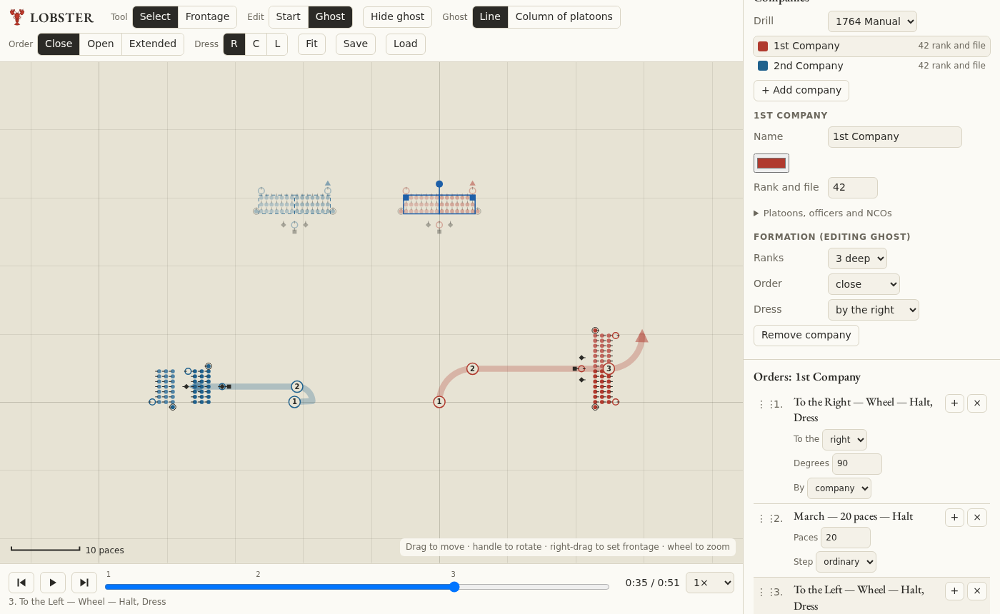

<p align="center"></p>

<h1 align="center">LOBSTER</h1>

<p align="center"><b>L</b>ine <b>O</b>rder <b>B</b>uilder &amp; <b>S</b>imulated <b>T</b>roop <b>E</b>volution <b>R</b>ehearser</p>

<p align="center"><i>Wheel, march, dress, repeat.</i></p>

---

LOBSTER is a browser tool for planning and rehearsing 18th-century line-infantry drill. You place a company on the field, drag out where you want it to end up, and give the words of command. It then replays what the company does, wheel by wheel, and tells you how close you got.

It's built for reenactors, wargamers and drill researchers who already know their facings from their wheelings and want to practise what to call out, or check what a given call would do.

Try it at https://lobster.18thcenturymaterialculture.org.



## What it does

The field is drawn from above, one dot per soldier, each with a tick showing which way he faces. Officers, sergeants, corporals and the drummer have their own marks, and a chevron marks the directing file.

You shape a company the way you would in Total War: drag it to move it, turn it by its handle, and right-drag a line across the field to set a new frontage, which spreads or deepens the ranks to fit. Each company has a see-through ghost for where it should finish, as a line or an open column of platoons.

Each company has its own rank and file, telling off into platoons, officers and NCOs, depth (2 or 3 deep), order (close, open or extended) and dressing point (right, centre or left).

The orders you can give so far are march, face, wheel by company or by platoons, take order, dress, form deep and mark time. An order that can't be given from where the company stands is marked with the reason.

The replay follows the drill rather than sliding men into place. Wheels pivot on the flank man and follow the arc at the step's cadence, a march to a flank goes by files, and a change of order spreads from the dressing point. An arrow on the ground traces the path, numbered where each order is given, and several companies can drill at once. At the end, each company is compared with its ghost on position, front, shape, files, ranks, order and dressing.

Scenes save and load as JSON and autosave in the browser, and undo covers every change. All drill numbers and words of command live in one module, so other manuals (Steuben, the French 1791 Règlement) can be added later.

## Running it locally

Requires Node.js 20.19 or newer.

```bash
npm install
npm run dev
```

Open the URL Vite prints, usually http://localhost:5173.

On a Windows drive mounted in WSL (`/mnt/c`, `/mnt/e`), Vite can't see file changes, so restart it with `npx vite --force` after editing.

| Command | What it does |
|---|---|
| `npm run dev` | Development server |
| `npm test` | Unit tests (Vitest) |
| `npm run typecheck` | Type-check with `tsc` |
| `npm run build` | Type-check and build the static site into `dist/` |
| `npm run preview` | Serve the built `dist/` locally |

## How to use it

New here? The "I don't know what I'm doing" button in the toolbar opens a short walkthrough.

| To… | Do this |
|---|---|
| Pan or zoom | Drag empty ground, or use the mouse wheel. Fit frames every company |
| Choose what you're editing | Edit: Start or Ghost, in the toolbar |
| Move a company | Drag it |
| Rotate | Drag the round handle in front of it. Hold Shift to snap to 45° |
| Set frontage | Right-drag from one flank to the other, or use the Frontage tool. The men face to the left of the drag direction |
| Widen or narrow | Drag a flank square |
| Select several | Shift-click |
| Give orders | Use + March, + Wheel and the other buttons in the Orders panel. Edit parameters inline, and reorder with ↑ ↓ or by dragging |
| Replay | Play or pause with Space, step between orders, scrub, and speed up to 4×. Click an order's words to jump to it |
| Chain exercises | Make this the start turns the end of the replay into the new starting position |
| Undo or redo | Ctrl+Z, Ctrl+Shift+Z |
| Edit from the keyboard | Tab to the field. Arrow keys move the selected company, `[` and `]` rotate it, `+` and `-` change its depth. Hold Shift for bigger steps; Escape clears the selection |

LOBSTER is built for desktop browsers with a mouse or trackpad. There is no phone layout, by choice.

## Status and drill sources

LOBSTER is early work. The British 1764 Manual is the first drill system, and its numbers are placeholders: file intervals, rank distances, paces per minute, where officers and NCOs are posted, and the exact words of command. They're marked `SOURCE NEEDED` in [`src/drill/gb1764.ts`](src/drill/gb1764.ts), and the app says so in the Orders panel. Corrections with citations (the Manual, Cuthbertson, regimental standing orders) are welcome.

Next on the list:
- working out the orders from the ghost (the Suggest orders button)
- typing words of command as free text
- more commands: inclines, successive wheels of a column, firings
- battalion level
- other drill manuals

The design and implementation notes are in [`docs/superpowers/`](docs/superpowers/).

## Deploying

Every push to `main` deploys the live site through [`.github/workflows/deploy.yml`](.github/workflows/deploy.yml): tests, build, upload to S3, then a CloudFront cache refresh. Pull requests run the tests and the build only ([`ci.yml`](.github/workflows/ci.yml)).

The site is a private S3 bucket behind CloudFront, with an ACM certificate and Route53 records under the existing `18thcenturymaterialculture.org` zone. It's all defined in [`terraform/`](terraform/), which keeps its state in the material-culture Terraform state bucket under its own key.

GitHub holds no AWS secrets. The workflow signs in with GitHub OIDC and assumes a role that only `main` of this repo can use, and that can only write to this site's bucket and refresh its CloudFront distribution. The repo has four non-secret Actions variables: `AWS_DEPLOY_ROLE_ARN`, `S3_BUCKET`, `CF_DISTRIBUTION_ID` and `SITE_URL`. Terraform state and `*.tfvars` files are gitignored.

To set up or change the infrastructure (needs AWS credentials locally):

```bash
make infra-init
make infra-plan
make infra-apply
make github-vars   # copies the Terraform outputs into the repo's Actions variables
```

`make deploy` builds and uploads from your machine if you ever need to bypass CI. The build is a static site with relative asset paths, so it also runs on any other static host.

## Project layout

```
src/model/    formation geometry, telling off, soldier layout
src/drill/    drill systems (gb1764.ts) and their types
src/engine/   order primitives, timeline execution, ghost comparison
src/state/    scene store, undo/redo, persistence, replay clock
src/ui/       canvas renderer, interactions, panels
public/       static assets (the lobster in its cocked hat)
terraform/    AWS hosting (S3, CloudFront, ACM, Route53, OIDC deploy role)
.github/      CI and deploy workflows
tests/        Vitest unit tests
docs/         screenshot, design and implementation plan
```

## Licence

Not yet chosen.
